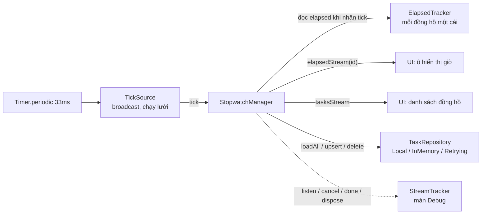

# Multi-Stopwatch

App Flutter đồng hồ bấm giờ đa tác vụ: nhiều đồng hồ chạy song song và độc lập với nhau. Đây là đồ án nhóm môn **Lập trình Đa nền tảng**, chủ đề **Lập trình bất đồng bộ với Future & Stream**.

> **Hiện trạng:** lớp business logic (`lib/core/`) đã hoàn thành và có test đầy đủ. Giao diện đang được làm: `lib/main.dart` hiện vẫn là app mẫu (counter) do `flutter create` sinh ra, nên `flutter run` lúc này chưa hiển thị đồng hồ.

## Tính năng lớp core

- **TickSource broadcast:** một Timer dùng chung cho mọi đồng hồ, phát qua `StreamController.broadcast`. Timer chỉ chạy khi có ít nhất một listener và tự dừng khi hết listener.
- **Tính thời gian chính xác:** `elapsed = accumulated + (now − runningSince)`, không cộng dồn tick. Trong phiên đo bằng `Stopwatch`; timestamp được lưu để khôi phục sau khi tắt/mở app; thời gian máy ngủ khi app ở nền được tự bù.
- **StopwatchManager:** nhiều đồng hồ chạy song song với start/pause/resume/reset/lap; mỗi lap có lap time và chênh lệch so với lap trước. `tasksStream` cho danh sách, `elapsedStream(id)` cho từng đồng hồ. Lệnh chạy tuần tự đúng thứ tự gọi; lưu lỗi thì trạng thái được hoàn tác.
- **Throttle và debounce tự viết** bằng `StreamTransformer` (không dùng rxdart): xử lý đúng cancel, pause/resume, done, lỗi; hỗ trợ cả stream single-subscription lẫn broadcast.
- **Repository:** `LocalTaskRepository` (shared_preferences + JSON có version), `InMemoryTaskRepository` (giả lập API bằng `Future.delayed`, giả lập lỗi), `RetryingTaskRepository` (thử lại với thời gian chờ tăng dần). Manager nhận repository qua dependency injection.
- **Hủy luồng an toàn + StreamTracker:** `dispose()` gọi nhiều lần không lỗi, hủy mọi subscription và Timer, đóng mọi controller, không phát sự kiện sau khi đóng. `StreamTracker` đếm subscription đang hoạt động và phát log listen/cancel/done/dispose cho màn Debug.

Hợp đồng API chi tiết cho người làm UI: [docs/API_CONTRACT.md](docs/API_CONTRACT.md).

## Kiến trúc

```text
lib/
├── main.dart            điểm vào app (hiện là app mẫu của Flutter)
└── core/                business logic
    ├── models/          StopwatchTask, TaskSnapshot, Lap, TaskStatus (immutable, JSON)
    ├── ticker/          TickSource, ElapsedTracker, TimeSource
    ├── services/        StopwatchService (hợp đồng), StopwatchManager, exception
    ├── storage/         TaskRepository, Local / InMemory / Retrying
    ├── transformers/    throttle, debounce
    └── debug/           StreamTracker
test/
├── widget_test.dart     test của app mẫu
└── core/                test cho từng thư mục của lib/core (support/ là phần dùng chung)
docs/
└── API_CONTRACT.md      hợp đồng API cho người làm UI
```

Luồng dữ liệu từ tick tới giao diện:



- Tick chỉ là tín hiệu "đọc lại thời gian"; giá trị elapsed luôn tính từ đồng hồ thật, nên tick đến trễ hay bị bỏ nhịp cũng không làm sai giờ.
- Manager chỉ nghe tick cho đồng hồ **đang chạy và có người nghe** `elapsedStream`; không có gì cần cập nhật thì Timer tắt hẳn.
- `tasksStream` chỉ phát khi trạng thái đổi (tạo, xóa, start, lap...), không phát theo từng tick, để danh sách không rebuild liên tục.

## Yêu cầu và cài đặt

| Thành phần | Phiên bản |
|---|---|
| Flutter | 3.47.7 (channel stable) |
| Dart | 3.13.5 (pubspec: `sdk: ^3.13.5`) |
| Android | Android SDK (cài qua Android Studio), JDK 17 trở lên |

Thư viện dùng: `shared_preferences`, `meta`; khi phát triển: `flutter_test`, `flutter_lints`, `fake_async`.

Cài đặt:

```bash
flutter doctor     # kiểm tra Flutter, Android SDK, thiết bị
flutter pub get    # tải thư viện
```

### Chạy trên máy Android thật

1. Trên điện thoại: bật **Tùy chọn nhà phát triển** và **Gỡ lỗi USB**, rồi cắm cáp vào máy tính và chấp nhận yêu cầu cho phép gỡ lỗi.
2. Kiểm tra thiết bị đã được nhận và chạy app:

```bash
flutter devices
flutter run -d <device-id>
```

### Chạy trên emulator Android

1. Tạo một thiết bị ảo trong Android Studio (**Device Manager**).
2. Mở emulator rồi chạy app:

```bash
flutter emulators
flutter emulators --launch <emulator-id>
flutter run
```

### Chạy test

```bash
flutter test
```

Kết quả đúng kết thúc bằng dòng `All tests passed!`. Xem thêm ở mục [Chạy test và đọc kết quả](#chạy-test-và-đọc-kết-quả).

## Cấu hình môi trường

- Dự án **không dùng API key**, **không cần file `.env`**, **không cần `google-services.json`** (không dùng Firebase).
- Dữ liệu hoàn toàn cục bộ hoặc giả lập: lưu trên máy bằng shared_preferences (`LocalTaskRepository`), hoặc giả lập API ngay trong bộ nhớ (`InMemoryTaskRepository`). App không gọi dịch vụ bên ngoài nào.
- Sau `flutter pub get` là chạy được, không cần cấu hình thêm.

## Chạy test và đọc kết quả

| Lệnh | Tác dụng |
|---|---|
| `flutter test` | Chạy toàn bộ test |
| `flutter test test/core` | Chỉ chạy test của lớp core |
| `flutter test test/core/ticker/tick_source_test.dart` | Chạy một file |
| `flutter test --plain-name "hủy luồng an toàn"` | Chạy các test có tên chứa đoạn chữ này |
| `flutter test --reporter expanded` | In tên từng test khi chạy |
| `flutter test --coverage` | Tạo báo cáo độ phủ ở `coverage/lcov.info` |

Phần lớn test dùng `fake_async` (thời gian ảo), nên kịch bản "chạy 1 giờ" chỉ mất vài giây. Riêng nhóm test "đồng hồ thật" chạy trên event loop thật.

Các test chứng minh yêu cầu chính:

| Yêu cầu | File test |
|---|---|
| Sau dispose không còn listener, Timer, subscription | `test/core/services/stopwatch_manager_test.dart` (nhóm "hủy luồng an toàn"), `test/core/ticker/tick_source_test.dart` |
| Tick broadcast tới nhiều listener | `test/core/ticker/tick_source_test.dart` |
| Throttle/debounce đúng thời gian | `test/core/transformers/rate_limit_test.dart` |
| Khôi phục đúng thời gian sau restart giả lập | `test/core/services/stopwatch_manager_test.dart` (nhóm "khởi động lại"), `test/core/storage/local_task_repository_test.dart` |
| Không trôi thời gian khi chạy lâu | `test/core/ticker/elapsed_tracker_test.dart`, `test/core/services/stopwatch_manager_test.dart` (nhóm "không trôi khi chạy lâu") |

### Đọc kết quả test hủy luồng

```bash
flutter test test/core/services/stopwatch_manager_test.dart --plain-name "hủy luồng an toàn" --reporter expanded
```

Kết quả khi đạt:

```text
00:00 +0: hủy luồng an toàn (StreamTracker) sau dispose: hasListener == false, không còn Timer, số subscription active về 0, không phát sự kiện nào sau khi đóng
00:00 +1: hủy luồng an toàn (StreamTracker) TickSource tự tạo cũng bị dispose; log ghi đúng thứ tự hủy
00:00 +2: hủy luồng an toàn (StreamTracker) gọi dispose nhiều lần, kể cả đồng thời, chỉ dọn dẹp một lần
00:00 +3: hủy luồng an toàn (StreamTracker) listener đang pause lúc dispose: không có sự kiện nào phát vào controller đã đóng; resume thì nhận done và tracker về 0
00:00 +4: All tests passed!
```

- `+N` là số test đã qua; nếu có test lỗi sẽ xuất hiện thêm `-N`, kèm dòng `Expected: ...` / `Actual: ...` chỉ ra điều kiện bị vi phạm.
- Test đầu tiên mở 3 đồng hồ (2 cái đang chạy) với 7 subscription, gọi `dispose()` khi còn một lệnh lap đang chờ lưu, rồi kiểm tra:
  - `ticks.hasListener == false`: không còn ai nghe TickSource.
  - `periodicTimerCount == 0` và `pendingTimers` rỗng: không còn Timer nào, kể cả Timer một lần.
  - `tracker.activeCount == 0`: mọi subscription đã kết thúc.
  - Mọi listener nhận done, không có lỗi; chạy thêm 5 giây ảo không có sự kiện hay log mới, tức không phát gì sau khi đóng.
- Test thứ hai kiểm tra thứ tự log của `StreamTracker`: listen elapsed → listen tick → cancel tick → done elapsed → dispose TickSource → dispose StopwatchManager.

Test tương tự cho riêng TickSource:

```bash
flutter test test/core/ticker/tick_source_test.dart --plain-name "StreamTracker" --reporter expanded
```

## Phân công thành viên

<!-- TODO: bạn cùng nhóm bổ sung -->

## Phần UI/State (flutter_bloc)

<!-- TODO: bạn cùng nhóm bổ sung -->
