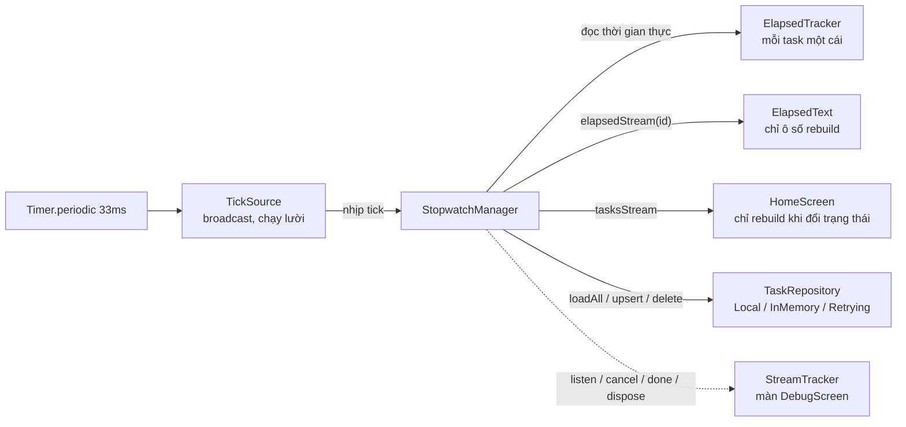

# Multi-Stopwatch

Ứng dụng Flutter đồng hồ bấm giờ đa tác vụ: cho phép tạo, quản lý và chạy đồng thời nhiều đồng hồ song song và độc lập với nhau. Đây là đồ án môn học **Lập trình Đa nền tảng**, chủ đề **Lập trình bất đồng bộ với Future & Stream** trong Dart & Flutter.

> **Trạng thái dự án:** Đã hoàn thiện toàn diện 100% cả lớp **Business Logic** (`lib/core/`) và **Giao diện & State Management** (`lib/ui/`). Ứng dụng đã tích hợp hoàn chỉnh tại `lib/main.dart`, vượt qua toàn bộ **221/221 bài kiểm thử tự động** (`flutter test`) và đạt chuẩn tuyệt đối **0 cảnh báo lint** (`flutter analyze`).

---

## Tính năng nổi bật

### 1. Tầng Business Logic & Reactive Core (`lib/core/`)
- **Nguồn nhịp dùng chung Lazy (`TickSource`):** Sử dụng duy nhất một `Timer.periodic(33ms)` (~30fps) dùng chung cho mọi đồng hồ qua `StreamController.broadcast`. Cơ chế chạy lười (Lazy Evaluation) tận dụng callback `onListen`/`onCancel`: Timer chỉ chạy khi có ít nhất một listener và tự động dừng ngay khi hết listener, giúp ứng dụng đạt mức **0% CPU** khi không có ai lắng nghe.
- **Tính thời gian chính xác tuyệt đối, không trôi giờ (`ElapsedTracker`):**
  - **Không cộng dồn tick:** Tránh hoàn toàn sai số tích lũy do giật lag, GC hoặc app xuống nền.
  - **Thuật toán mốc thời gian:** $\text{elapsed} = \text{accumulated} + (\text{now} - \text{runningSince})$.
  - **Nguồn thời gian kép (`TimeSource`):** Trong phiên dùng đồng hồ đơn điệu `Stopwatch` (không bị nhảy khi chỉnh giờ hệ thống); lưu mốc UTC để tự bù thời gian khi thiết bị ngủ (Sleep mode) hoặc sau khi tắt/mở lại app.
- **Bộ điều phối trung tâm (`StopwatchManager`):**
  - Quản lý đồng thời nhiều đồng hồ với đầy đủ thao tác: tạo mới, start, pause, resume, reset, lap, đổi tên, đổi màu, xóa.
  - Phân tách 2 luồng Stream độc lập: `tasksStream` (chỉ phát khi trạng thái danh sách thay đổi, chống rebuild thừa) và `elapsedStream(id)` (phát dữ liệu thời gian cho từng đồng hồ theo tick).
  - Tuần tự hóa hàng đợi lệnh (Queue execution) tránh xung đột (Race Condition) và **tự động hoàn tác (Rollback)** trạng thái trong bộ nhớ nếu lưu đĩa thất bại.
  - Hỗ trợ đầy đủ thao tác hàng loạt: `runAll`, `pauseAll`, `resetAll`, `deleteAll`.
- **Stream Transformers thuần Dart (`rate_limit.dart`):**
  - Tự triển khai bằng `StreamTransformerBase` của Dart SDK, **tuyệt đối không dùng thư viện ngoài (`rxdart`)**.
  - `ThrottleTransformer` kèm cờ `trailing: true`: Giảm tải tần suất phát nhưng **không bao giờ mất frame cuối cùng** khi người dùng bấm Pause hoặc Reset.
  - `DebounceTransformer`: Trì hoãn 300ms sau phím bấm cuối cùng ở ô tìm kiếm, loại bỏ truy vấn liên tục.
  - Quản lý trọn vẹn vòng đời: Pause/resume lan ngược về nguồn, dọn dẹp Timer lập tức khi cancel, xả sạch sự kiện pending trước khi done.
- **Tầng lưu trữ đa dạng & Khả năng chịu lỗi (`storage/`):**
  - `LocalTaskRepository`: Lưu dữ liệu vào `SharedPreferences` dạng JSON có version (`version: 1`).
  - `InMemoryTaskRepository`: Giả lập API trong bộ nhớ với độ trễ mạng (`latency`) và tỷ lệ lỗi ngẫu nhiên (`failureRate`).
  - `RetryingTaskRepository`: Áp dụng Decorator Pattern, tự động thử lại khi gặp `StorageException` với thời gian chờ tăng dần (Exponential backoff).
- **Bộ giám sát Stream & Chống rò rỉ (`StreamTracker`):**
  - Bọc các stream để đếm số lượng subscription đang hoạt động (`activeCount`, `activeBySource`) theo thời gian thực.
  - Ghi nhận lịch sử 4 loại sự kiện vòng đời: `listen`, `cancel`, `done`, `dispose`.
  - Minh chứng khoa học: Khi thoát màn hình hoặc app đóng, số subscription active luôn trở về **0**.
- **Phòng thí nghiệm Event Loop (`EventLabRunner`):**
  - Ứng dụng kỹ thuật `Zone.current.fork` để bẫy và chặn `scheduleMicrotask` và `createTimer`.
  - Chạy thực tế và đo đạc thứ tự thực thi thật của 6 kịch bản bất đồng bộ kinh điển: Call Stack (`Sync`) $\to$ `Microtask Queue` $\to$ `Event Queue (Timer)`.

### 2. Tầng Giao diện & State Management (`lib/ui/`)
- **Quản lý State bằng `InheritedWidget` (`StopwatchScope`):** Tinh gọn, thuần Flutter, không phụ thuộc thư viện bên ngoài (như Bloc, Provider hay GetX). Phân phối `StopwatchService` và `StreamTracker` xuống toàn bộ widget tree sạch sẽ, quản lý vòng đời khởi tạo và `dispose()` tại gốc `MultiStopwatchApp`.
- **Kỹ thuật tối ưu hóa Render 60fps (`ElapsedText`):** Cô lập phạm vi rebuild chỉ trong đúng ô chữ số thời gian. Mỗi nhịp tick 33ms chỉ vẽ lại Text thời gian, toàn bộ cấu trúc `TaskCard` cha, nút bấm và danh sách bên ngoài hoàn toàn đứng yên. Sử dụng font chữ `monospace` chống rung giật chữ số.
- **Màn hình chính (`HomeScreen`):**
  - **Batch Operations Toolbar:** Thanh công cụ điều khiển đồng loạt (*Chạy tất cả*, *Tạm dừng tất cả*, *Reset tất cả*, *Xóa tất cả*). Nút bấm tự động bật/tắt theo ngữ cảnh dữ liệu; hộp thoại xác nhận cảnh báo số lượng khi Reset/Xóa.
  - **Tìm kiếm Debounced 300ms:** Nhập liệu mượt mà, phản hồi tức thì, không gây giật lag.
  - **Giao diện thích ứng (Responsive):** Tự động chuyển đổi giữa `ListView` (màn hình hẹp) và `GridView` (màn hình rộng).
- **Màn hình chi tiết (`TaskDetailScreen`):** Đồng hồ số kích thước lớn, bảng ghi nhận vòng chạy (Lap Recording) tự động tính chênh lệch **Delta** so với vòng trước và tô màu trực quan (Xanh lá nếu nhanh hơn, Đỏ nếu chậm hơn). Thoát màn hình tự động hủy subscription nghe giờ.
- **Màn hình công cụ trực quan (`DebugScreen` & `EventLabScreen`):**
  - `DebugScreen`: Trực quan hóa số subscription đang active và dòng log thời gian thực.
  - `EventLabScreen`: Chạy thực nghiệm 6 kịch bản bất đồng bộ và hiển thị tag màu `SYNC`, `MICROTASK`, `EVENT`.

---

## Kiến trúc thư mục

```text
lib/
├── main.dart               Điểm vào ứng dụng (MultiStopwatchApp, StopwatchScope)
├── core/                   Business Logic & Reactive Streams (thuần Dart)
│   ├── models/             StopwatchTask, TaskSnapshot, Lap, TaskStatus (immutable, JSON)
│   ├── ticker/             TickSource (broadcast lazy), ElapsedTracker, TimeSource
│   ├── services/           StopwatchService (hợp đồng API), StopwatchManager, exceptions
│   ├── storage/            TaskRepository, Local / InMemory / Retrying
│   ├── transformers/       ThrottleTransformer (trailing: true), DebounceTransformer
│   ├── debug/              StreamTracker (giám sát subscription, log vòng đời)
│   └── lab/                EventLabRunner, LabEvent (thực nghiệm Event Loop qua Zone)
└── ui/                     Giao diện & State Management
    ├── scope/              StopwatchScope (InheritedWidget phân phối service & tracker)
    ├── screens/            HomeScreen, TaskDetailScreen, DebugScreen, EventLabScreen
    ├── widgets/            ElapsedText (cô lập rebuild 60fps), TaskCard
    └── utils/              TimeFormatters (mm:ss.cs / hh:mm:ss.cs)
test/
├── core/                   Unit & Integration tests cho từng module của lib/core/
│   ├── debug/              StreamTracker tests
│   ├── lab/                EventLabRunner tests
│   ├── models/             Model serialization & immutability tests
│   ├── services/           StopwatchManager integration tests (chống trôi, rollback, an toàn dispose)
│   ├── storage/            Local, InMemory & Retrying repository tests
│   ├── support/            CountingTaskRepository, FakeTimeSource
│   ├── ticker/             TickSource lazy & ElapsedTracker tests
│   └── transformers/       Throttle & Debounce stream tests
└── ui/                     Widget tests cho toàn bộ giao diện & vòng đời stream
    ├── fakes/              FakeStopwatchService viết tay phục vụ test UI
    ├── screens/            HomeScreen, TaskDetailScreen, DebugScreen, EventLabScreen tests
    ├── utils/              TimeFormatters tests
    ├── widgets/            ElapsedText & TaskCard tests
    ├── app_smoke_test.dart Khởi động ứng dụng end-to-end
    └── subscription_lifecycle_test.dart  Đối soát vòng đời hủy subscription (Zero Leak)
docs/
└── API_CONTRACT.md         Hợp đồng API chi tiết giữa Core và UI
```

---

## Luồng dữ liệu Reactive (Data Flow)



- **Tick chỉ là tín hiệu "đọc lại giờ":** Giá trị thời gian luôn tính từ mốc đồng hồ thật (`now - runningSince`), tick đến trễ hoặc bị bỏ nhịp cũng không làm sai lệch thời gian tích lũy.
- **Tiết kiệm tài nguyên:** `StopwatchManager` chỉ lắng nghe tick cho đồng hồ **đang chạy và có widget lắng nghe** `elapsedStream`; khi không có gì cần hiển thị, Timer tự động tắt hoàn toàn.
- **Cô lập Rebuild:** `tasksStream` chỉ phát khi danh sách/trạng thái thay đổi, `elapsedStream` đi thẳng vào `ElapsedText`, giữ cho `HomeScreen` và các thẻ `TaskCard` đứng yên không bị vẽ lại thừa thãi.

---

## Phân công thành viên & Đóng góp

Dự án được xây dựng bởi nhóm 2 sinh viên với phân định ranh giới module rõ ràng thông qua hợp đồng API độc lập (`StopwatchService`):

| Thành viên | Vai trò | Nội dung đảm nhiệm chính | Đóng góp |
|:---|:---|:---|:---:|
| **Sinh viên 1** | **Business Logic & Developer API** | • Thiết kế kiến trúc Core Reactive thuần Dart (không dùng `rxdart`).<br>• Triển khai `TickSource` broadcast lazy và `ElapsedTracker` chống trôi giờ.<br>• Tự viết `ThrottleTransformer` (trailing) và `DebounceTransformer`.<br>• Xây dựng tầng lưu trữ chịu lỗi, Retrying Decorator và cơ chế tự động Rollback.<br>• Triển khai bộ đếm `StreamTracker` chống rò rỉ và Dart Zone `EventLabRunner`.<br>• Soạn thảo hợp đồng `API_CONTRACT.md` & thiết kế Slide thuyết trình. | **55%** |
| **Sinh viên 2** | **UI & State Management** | • Thiết kế kiến trúc State bằng `StopwatchScope` (`InheritedWidget`).<br>• Tối ưu hiệu năng dựng hình 60fps với component `ElapsedText`.<br>• Xây dựng `HomeScreen` (Responsive, Batch Operations toolbar, tìm kiếm Debounce).<br>• Xây dựng `TaskDetailScreen` (bấm Lap, trực quan hóa chênh lệch Lap Delta).<br>• Xây dựng các màn hình công cụ: `DebugScreen`, `EventLabScreen`.<br>• Xây dựng toàn bộ bộ Widget Tests & đối soát vòng đời hủy subscription. | **45%** |

---

## Hướng dẫn cài đặt và chạy ứng dụng

### Yêu cầu môi trường
- **Flutter SDK:** 3.47.7 (channel stable)
- **Dart SDK:** 3.13.5 (pubspec: `sdk: ^3.13.0`)
- **Android:** Android SDK, JDK 17 trở lên
- **Thư viện sử dụng:** `meta`, `shared_preferences`, `cupertino_icons`
- **Thư viện dev:** `flutter_test`, `flutter_lints`, `fake_async`
- **Cấu hình môi trường:** Dự án **không dùng API key**, **không cần `.env`**, **không dùng Firebase**; dữ liệu hoàn toàn cục bộ hoặc giả lập trong bộ nhớ.

### Cài đặt thư viện
```bash
flutter doctor     # Kiểm tra Flutter và Android SDK
flutter pub get    # Tải các gói phụ thuộc
```

### Chạy ứng dụng trên thiết bị / Máy ảo
```bash
# Kiểm tra danh sách thiết bị
flutter devices

# Chạy ứng dụng
flutter run
```

---

## Kiểm thử tự động & Đánh giá chất lượng

Dự án trang bị bộ kiểm thử tự động toàn diện bao phủ cả tầng logic nghiệp vụ, tính toán thời gian, khả năng chịu lỗi và kiểm thử giao diện:

```bash
# Chạy toàn bộ 221 bài kiểm thử
flutter test

# Kiểm tra phân tích tĩnh mã nguồn
flutter analyze
```

### Kết quả kiểm định thực tế
1. **Static Analysis (`flutter analyze`):**
   ```text
   Analyzing multi_stopwatch...
   No issues found!
   ```
2. **Automated Testing (`flutter test`):**
   ```text
   00:06 +221: All tests passed!
   ```

### Các nhóm kiểm thử tiêu biểu

| Nhóm yêu cầu kiểm định | File kiểm thử chính | Ý nghĩa |
|---|---|---|
| **Hủy luồng an toàn (Zero Leak)** | `test/core/services/stopwatch_manager_test.dart`<br>`test/ui/subscription_lifecycle_test.dart` | Chứng minh sau khi đóng màn hình/app: `hasListener == false`, không còn Timer nào chạy ngầm, số subscription active trên `StreamTracker` giảm chính xác về **0**. |
| **Không trôi giờ khi chạy lâu** | `test/core/ticker/elapsed_tracker_test.dart`<br>`test/core/services/stopwatch_manager_test.dart` | Chạy 100 giờ ảo bằng `fake_async` và kiểm chứng sai số bằng **0ms**, đối soát bù giờ khi máy ngủ và chống lùi giờ hệ thống. |
| **Nguồn nhịp Broadcast Lazy** | `test/core/ticker/tick_source_test.dart` | Xác nhận Timer chỉ bật khi có listener đầu tiên và tự tắt khi hết listener. |
| **Rate Limit Thuần Dart** | `test/core/transformers/rate_limit_test.dart` | Kiểm tra thời gian chính xác của Throttle (kèm cờ trailing) và Debounce. |
| **Thứ tự Event Loop khớp lý thuyết** | `test/core/lab/event_lab_runner_test.dart` | Chạy thực nghiệm 6 kịch bản bằng Dart Zone, đối chiếu thứ tự Call Stack $\to$ Microtask $\to$ Event Queue. |
| **Kiểm thử Widget & Rebuild** | `test/ui/screens/home_screen_test.dart`<br>`test/ui/widgets/elapsed_text_test.dart` | Xác nhận các thao tác UI, thanh Toolbar hàng loạt, tìm kiếm debounce và tính độc lập khi vẽ lại của `ElapsedText`. |

---

## Tài liệu đính kèm & Bài báo cáo

- **Hợp đồng API chi tiết:** [docs/API_CONTRACT.md](docs/API_CONTRACT.md) — Mô tả chi tiết toàn bộ interface, models, exceptions và cách sử dụng cho lập trình viên.
- **File trình chiếu báo cáo (PowerPoint):** [Bao_Cao_Multi_Stopwatch.pptx](Bao_Cao_Multi_Stopwatch.pptx) — Bộ slide 14 trang chuẩn 16:9, thiết kế tối giản nền trắng, font chữ Times New Roman, tích hợp đầy đủ các đoạn code quan trọng và lời thoại thuyết trình (Speaker Notes) 15 phút.
